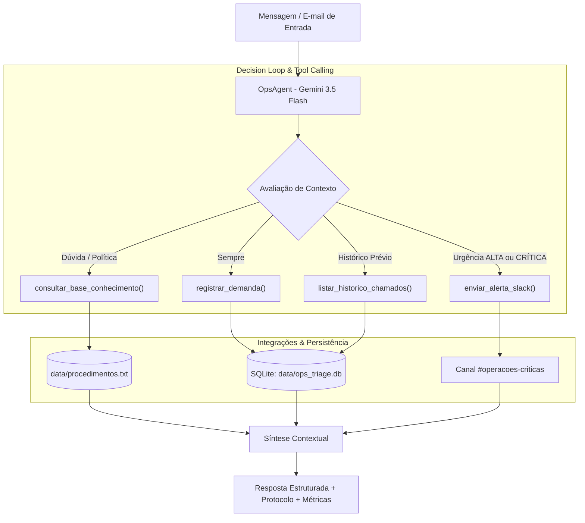

# OpsAgent - Agente Autônomo de Triagem e Operações Corporativas


Agente autônomo de inteligência artificial projetado para triagem operacional, resolução de procedimentos e roteamento de incidentes críticos corporativos utilizando **Tool Calling (Function Calling)** com o SDK oficial da Google GenAI.

---

## 🏗️ Arquitetura do Sistema



---

## 🎯 Dores de Negócio Resolvidas
Em ambientes corporativos com alto volume de demandas (operações, TI, atendimento B2B), a triagem manual gera gargalos e atrasos no SLA:
* **Detecção Imediata de Criticidade:** Identifica incidentes de alta severidade (ex: queda de serviços) e aciona o time técnico em tempo real.
* **Resolução Padronizada:** Consulta regras e políticas da empresa sem alucinações.
* **Rastreabilidade e Governança:** Todos os chamados geram protocolos únicos persistidos em banco de dados relacional (SQLite).
* **Observabilidade:** Monitoramento de tempo de execução (latência) e consumo de tokens (entrada/saída).

---

## 📂 Estrutura do Projeto

```
ops-triage-ai-agent/
├── data/
│   └── procedimentos.txt       # Base de conhecimento de políticas e SLA da empresa
├── evals/
│   └── casos_teste.json        # Conjunto de testes e cenários de avaliação (Evals)
├── scripts/
│   ├── check_models.py         # Diagnóstico de modelos disponíveis na API
│   └── run_evals.py            # Runner de benchmark e avaliação de cenários (Evals)
├── tests/
│   └── test_tools.py           # Testes unitários herméticos com pytest (tmp_path)
├── .env.example                # Modelo de variáveis de ambiente
├── .gitignore                  # Proteção de credenciais e caches
├── agent.py                    # Cérebro do agente, observabilidade e loop interativo
├── tools.py                    # Ferramentas com SQLite e tipagem estrita (Literal)
├── requirements.txt            # Dependências do projeto
└── README.md                   # Documentação arquitetural
```

---

## 🚀 Instalação e Execução

### 1. Clonar o Repositório e Instalar Dependências
```bash
git clone https://github.com/cesarafael-cpu/ops-triage-ai-agent.git
cd ops-triage-ai-agent
python -m venv .venv
source .venv/bin/activate  # No Windows: .\.venv\Scripts\Activate.ps1
pip install -r requirements.txt
```

### 2. Configurar Variáveis de Ambiente
Copie o arquivo `.env.example` para `.env`:
```bash
cp .env.example .env
```
Defina sua chave de API gratuita do [Google AI Studio](https://aistudio.google.com/):
```env
GEMINI_API_KEY="sua_chave_aqui"
GEMINI_PRIMARY_MODEL="gemini-3.5-flash"
GEMINI_FALLBACK_MODELS="gemini-3.1-flash-lite,gemini-3.7-flash,gemini-3.8-flash"
```

### 3. Execução

**Modo Console Interativo:**
```bash
python agent.py
```

**Modo Teste Automatizado:**
```bash
python agent.py --teste
```

---

## 🧪 Suíte de Testes Unitários

O projeto conta com testes unitários determinísticos cobrindo persistência relacional, unicidade de protocolos e isolamento hermético com fixtures `tmp_path`:

```bash
pytest tests/
```

---

## 🎯 Avaliação e Benchmark Agêntico (Evals)

Para validar a qualidade da tomada de decisão agêntica e resistência a prompt injection, execute a suíte de avaliações:

```bash
python scripts/run_evals.py
```

Saída esperada:
```text
tests/test_tools.py ..... [100%]
============================== 5 passed in 0.07s ==============================
```

---

## 📊 Exemplo de Saída e Observabilidade

```text
=================================================================
📥 MENSAGEM RECEBIDA:
De: Carlos Mendes (Diretor de Vendas)
Mensagem: Portal de login caiu! Apresentação em 10 minutos!
=================================================================
🤖 Agente em execucao (Modelo: gemini-3.5-flash)...

⚙️  [TOOL] consultar_base_conhecimento(termo='login')
💾 [TOOL] registrar_demanda: Gravado em SQLite -> REQ-20261121-A9F4B2 | Carlos Mendes | CRITICA
🚨 [TOOL] enviar_alerta_slack no canal '#operacoes-criticas'

📤 RESPOSTA FINAL DO AGENTE:
[Análise de Triagem, Protocolo REQ-20261121-A9F4B2 e Instruções de Contingência]

─────────────────────────────────────────────────────────────────
📊 METRICAS DE OBSERVABILIDADE & EXECUCAO:
  • Modelo Utilizado:  gemini-3.5-flash
  • Latencia Total:    2.41s
  • Tokens de Entrada: 412
  • Tokens de Saida:   188
  • Tokens Totais:     600
─────────────────────────────────────────────────────────────────
```
