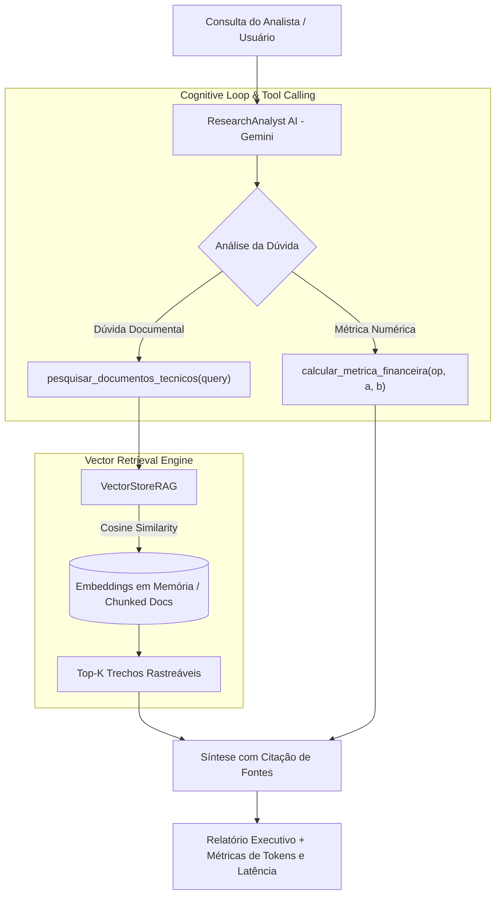

# ResearchAnalyst AI - Agente Especialista em Pesquisa e Síntese Técnica (RAG Avançado)

Agente autônomo projetado para auditoria documental, análise de relatórios financeiros e governança técnica utilizando **Retrieval-Augmented Generation (RAG)**, busca semântica por embeddings e cálculo determinístico via Tool Calling.

---

## 🏗️ Arquitetura do Motor RAG



---

## 🚀 Como Executar

### 1. Teste Automatizado:
```bash
python -m research_agent.agent --teste
```

### 2. Modo Console Interativo:
```bash
python -m research_agent.agent
```

### 3. Rodar Testes Unitários de RAG:
```bash
pytest research_agent/tests/
```
